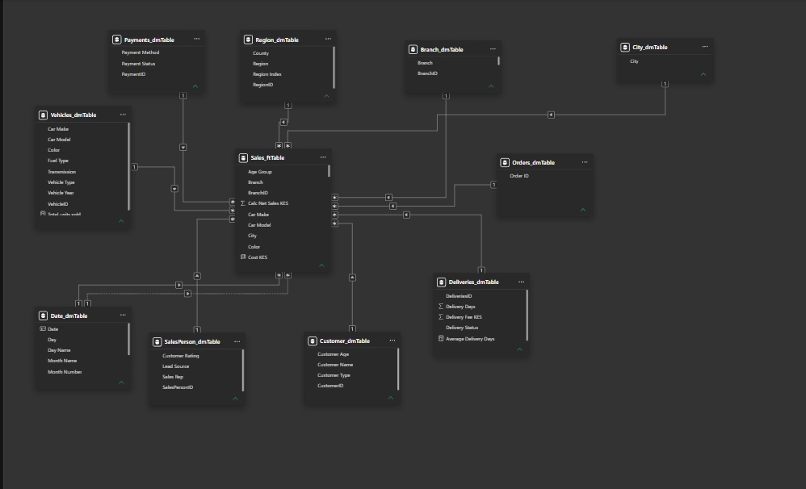

# JCars Logistics: Sales and Operations Analytics in Power BI

An end-to-end business intelligence project that turns a messy, flat vehicle-sales extract into a validated star-schema model, a DAX measure layer, and an interactive Power BI report that helps management understand performance, spot inefficiency and decide what to do next.

> **Project type:** Business Intelligence and Data Analyst assessment (LuxDev HQ)
> **Tools:** Power BI Desktop, Power Query (M), DAX
> **Article:** [Dev.to write-up](ADD-LINK-HERE)


---

## Table of contents

1. [Business problem](#1-business-problem)
2. [Dataset](#2-dataset)
3. [Repository structure](#3-repository-structure)
4. [Approach](#4-approach)
5. [Data quality issues and how they were handled](#5-data-quality-issues-and-how-they-were-handled)
6. [Currency standardisation](#6-currency-standardisation)
7. [Data model](#7-data-model)
8. [Business definitions and assumptions](#8-business-definitions-and-assumptions)
9. [DAX measures](#9-dax-measures)
10. [Report design](#10-report-design)
11. [Key findings](#11-key-findings)
12. [Recommendations](#12-recommendations)
13. [Challenges and lessons learned](#13-challenges-and-lessons-learned)
14. [How to reproduce](#14-how-to-reproduce)
15. [Limitations and next steps](#15-limitations-and-next-steps)
16. [Author](#16-author)

---

## 1. Business problem

JCars Logistics imports, sells and delivers vehicles across Kenya. Management needs one reliable view of the business that answers questions such as:

- How many cars were sold, and how much revenue and gross profit did they generate?
- Which makes, models, vehicle types, branches, regions, sales reps and lead sources perform best?
- Where is logistics cost high relative to the value it supports?
- How do payment status, delivery performance, discounts, ratings, returns and cancellations affect the business?
- Which orders and customers deserve investigation?

The raw data was not ready for this. It mixed currencies, inconsistent category spellings, text stored as numbers, impossible values and duplicate records. A large part of the project was investigating and fixing those problems **without silently discarding evidence**, then proving the cleaned data could be trusted.

## 2. Dataset

| Item | Detail |
|---|---|
| Source file | `Jcars_data.csv` |
| Grain | One row per sales order (`Order ID`) |
| Columns | 32 (order, customer, geography, branch, rep, vehicle, pricing, cost, payment, delivery, rating, return and recorded revenue fields) |
| Raw rows | `[ADD]` |
| Rows after de-duplication | `[ADD]` |
| Date range | `[ADD earliest]` to `[ADD latest]` |

All 32 columns are loaded as text and parsed deliberately, so no value is lost to an automatic type guess.

## 3. Repository structure

```
.
├── README.md
├── JCars_Logistics.pbix            # Power BI report and model
├── data/
│   ├── Jcars_data.csv              # raw extract
│   └── Jcars_clean.csv             # final cleaned dataset (export of Jcars_Clean)
├── powerquery/
│   └── Jcars_Clean.pq              # Staged, Clean, Audit_Duplicates, Audit_RowCounts queries
├── dax/
│   └── Jcars_DAX.dax               # calculated columns and measures
├── docs/
│   ├── data_quality_log.md         # every issue found and how it was handled
│   ├── assumptions_and_rules.md    # business definitions and assumptions
│   └── fx_rates.md                 # exchange rates, source and date
└── screenshots/
    ├── 01_executive_dashboard.png
    ├── 02_vehicle_performance.png
    ├── 03_geography_sales_team.png
    ├── 04_customers_pricing.png
    ├── 05_payments_delivery.png
    ├── 06_returns_exceptions.png
    ├── 07_insights_recommendations.png
    ├── model_view.png
    └── power_query_steps.png
```

No credentials, file-system secrets or personal identifiers are included. `[Confirm customer names are anonymised or already synthetic before publishing.]`

## 4. Approach

The project followed a deliberate sequence rather than going straight to charts:

1. **Audit** the data: define the grain, classify keys, attributes and measures, and test whether the candidate keys are unique.
2. **Standardise currency** to Kenya Shillings (KES) with one documented set of exchange rates.
3. **Clean in Power Query** with every transformation tied to an audit finding.
4. **Validate**: row counts, type checks, category checks, and a reconciliation of recorded revenue against price, units and discount.
5. **Model** the data as a star schema with a proper date table.
6. **Write DAX** measures on top of explicit business definitions.
7. **Design the report** as one analytical flow: dashboard, detail, investigation, insight, decision.
8. **Document** insights, recommendations, assumptions and lessons learned.

### Power Query design

The cleaning logic lives in four queries (`powerquery/Jcars_Clean.pq`):

| Query | Purpose |
|---|---|
| `Jcars_Staged` | Every CSV row, cleaned and flagged. Load disabled. |
| `Jcars_Clean` | First row per Order ID. This is the table loaded into the model. |
| `Audit_Duplicates` | Every copy of any repeated Order ID, so conflicts can be reviewed rather than hidden. |
| `Audit_RowCounts` | Reconciliation checks (rows read, kept and set aside, totals). |

Key design choices:

- **Exact-match mapping tables** for category clean-up (make, model, region, county, branch, lead source, payment, delivery and so on) instead of substring replacement, which can corrupt valid values. Unmapped values fall back to Proper Case.
- **Dedicated parsers** for dates, units, discount, age, vehicle year, rating, review count and money. Each returns a value plus an issue note.
- **Flag, don't delete.** Invalid values are nulled for calculations but recorded in a `Data Issues` column with an `Issue Count`. Rows with a missing Order ID are kept and given a surrogate key.
- **One money parser** detects the currency, strips symbols and the `M` (millions) suffix, preserves the sign, and converts with a single FX record.

## 5. Data quality issues and how they were handled

The full log is in [`docs/data_quality_log.md`](docs/data_quality_log.md). Summary of the main issue families:

| # | Issue | Why it matters | Handling |
|---|---|---|---|
| 1 | Money columns mixed KSh, KES, USD, EUR, ZAR, `$`, `€`, `R` and bare numbers | Summing mixed currencies gives meaningless totals | Detect currency, convert to KES, flag unknown currencies instead of assuming KES |
| 2 | Amounts written with `M` suffix, commas and symbols (for example `1.5M`) | Text cannot be aggregated | Parsed into numbers |
| 3 | Missing or placeholder values (`Null`, `N/A`, `-`, `?`, blank) | Hidden missing data distorts averages and counts | Standardised to null, labelled `Unknown` in dimensions |
| 4 | Inconsistent spellings and abbreviations for make, model, region, county, branch, lead source, payment and delivery status | One entity split across many labels | Exact-match mapping tables |
| 5 | Digit-for-letter substitutions in sales rep names (for example `K1ptoo`) | One rep appears as several | Normalised |
| 6 | Numbers written as words (`two`, `3 cars`, `thirty`, `Twenty Twenty`) | Fails numeric conversion | Parsed with a word map |
| 7 | Discounts mixing scales (`10%`, `ten percent`, `10`, `0.1`) | 10 and 10% would differ by 100x | Normalised to a fraction |
| 8 | Impossible ages, units, ratings and vehicle years | Skews averages and rankings | Nulled for calculation and flagged |
| 9 | Duplicate and missing Order IDs | Double-counting or lost sales | First row kept, duplicates audited, missing IDs kept and flagged |
| 10 | Ambiguous colour code (`Gre`) | Cannot tell Grey from Green | Left as `Unknown` |
| 11 | Recorded revenue that may not reconcile with price × units × discount | Revenue could be misstated | `Revenue Check` column and investigation |
| 12 | Missing region or county | Gaps in geographic analysis | Filled from city or county where unambiguous, with an `Imputed` flag |

## 6. Currency standardisation

All monetary values are expressed in **KES**. Values with no stated currency are treated as KES.

| Currency | KES per 1 unit |
|---|---|
| USD | 129.00 |
| EUR | 151.00 |
| ZAR | 7.91 |

**Source and date:** `[ADD source, for example Central Bank of Kenya, and the rate date]`

One fixed rate set is used for all rows so that results are consistent and reproducible. The trade-off is that it ignores historical exchange-rate movement. Currencies that cannot be identified are not converted and are flagged for review. Details are in [`docs/fx_rates.md`](docs/fx_rates.md).

## 7. Data model

The model is a star schema with one fact table and conformed dimensions.



| Table | Type | Contents |
|---|---|---|
| `Sales_ftTable` | Fact | Order Key and Order ID, order and delivery dates, dimension keys, units, prices, costs, discount, delivery fee, logistics cost, revenue fields, delivery days, rating, returned flag, validation flags |
| `Customer_dmTable` | Dimension | Customer name and type |
| `Vehicles_dmTable` | Dimension | Make, model, vehicle type, fuel, transmission, colour, year |
| `Branch_dmTable` | Dimension | Branch |
| `Region_dmTable` | Dimension | Region and county |
| `SalesPerson_dmTable` | Dimension | Sales rep and lead source |
| `Payments_dmTable` | Dimension | Payment method and status |
| `Deliveries_dmTable` | Dimension | Delivery status |
| `Orders_dmTable` | Dimension | Order identifier attributes |
| `Date_dmTable` | Dimension | Calendar table, marked as the date table |

**Design decisions**

- All relationships are one-to-many, single direction, from dimension to fact.
- Each dimension is built on its own grain (distinct combinations of its attributes). The fact is joined on all of those columns so rows are never multiplied.
- Measure columns (units, fees, cost, rating) live in the fact so that slicers on any dimension filter them correctly.
- `Order Date` is the active relationship to the date table. `Delivery Date` is an inactive relationship, activated with `USERELATIONSHIP` in delivery measures.
- Key columns are hidden from Report view.

**Integrity checks:** fact row count equals `Jcars_Clean`; fact revenue equals source revenue; every dimension key resolves; attributes in the fact match their dimension values.

## 8. Business definitions and assumptions

Full rules are in [`docs/assumptions_and_rules.md`](docs/assumptions_and_rules.md).

| Term | Definition used |
|---|---|
| Valid sale | An order whose payment status and delivery status are not "Cancelled" |
| Revenue | `Units Sold × Unit Selling Price (KES) × (1 − Discount)`, valid sales only. Recorded revenue is reconciled against this. |
| Cost of sales | `Units Sold × Unit Cost (KES)` |
| Gross profit | Revenue − Cost of sales |
| Gross margin % | Gross profit ÷ revenue, calculated only on rows that have both revenue and cost |
| Profit after logistics | Gross profit − logistics cost |
| Returned order | `Returned = Yes`. Stays in revenue; `Revenue After Returns` shows the effect. |
| Cancelled order | Payment or delivery status is "Cancelled". Excluded from sales, reported separately. |
| Outstanding revenue | Revenue on orders with payment status Pending or Partially Paid (the paid portion is unknown) |
| Customer value | Revenue per customer, with unknown customer names excluded from rankings |

**Other assumptions**

- Dates are read as dd/mm/yyyy first, then mm/dd/yyyy.
- A missing discount is treated as 0 only inside the calculated revenue.
- `Mt Kenya` is mapped to Central. `Held` and `Late` are treated as Delayed.
- Valid ages are 18–100, valid ratings 1–5, valid vehicle years 1980 to next year.
- `[ADD any assumption you made about whether recorded revenue includes the delivery fee, based on Revenue Check results]`

## 9. DAX measures

The full set is in [`dax/Jcars_DAX.dax`](dax/Jcars_DAX.dax). Measures sit in a dedicated `_Measures` table.

| Group | Examples |
|---|---|
| Core | Cars Sold, Orders, Revenue, Gross Profit, Gross Profit Margin %, Customers |
| Discount | Weighted Discount %, Discount Value |
| Logistics | Logistics Cost %, Profit after Logistics, Margin after Logistics % |
| Delivery | Avg Delivery Days, Delivered %, Delayed %, Open Deliveries |
| Payments | Collected Revenue, Outstanding Revenue, Outstanding % |
| Returns and cancellations | Return Rate, Cancellation Rate, Cancelled Value |
| Ratings | Avg Rating, Rating Coverage % |
| Ranking and contribution | Revenue % of Total, Make, Model, Branch, Rep and Customer ranks |
| Time intelligence | Revenue LY, YoY %, YTD, MoM %, Rolling 3M |
| Exceptions | P90 thresholds, Exception Score, Orders to Investigate |
| Data quality | Rows With Data Issues %, Rows Missing Cost, Revenue Mismatch Orders |

## 10. Report design

The report follows one analytical flow: **monitor, investigate, explain, decide.**

| Page | Purpose |
|---|---|
| 1. Executive Dashboard | One-page answer to "How is JCars performing?": KPI cards, revenue and profit trend, top makes, branch comparison, attention indicators, slicers |
| 2. Vehicle Performance | Makes, models, vehicle types, margins, manufacture year |
| 3. Geography and Sales Team | Region, county, branch, sales reps, lead sources |
| 4. Customers and Pricing | Customer types, top customers, discount and rating relationships |
| 5. Payments and Delivery | Payment methods and status, delivery status and speed, logistics cost relative to value |
| 6. Returns and Exceptions | Returns and cancellations by vehicle, orders needing investigation, data quality |
| 7. Insights and Recommendations | Findings and evidence-based actions |
| Drill-through (hidden) | `[ADD, for example Model Detail]` |
| Tooltip (hidden) | `[ADD, for example Branch tooltip]` |

**Interactivity:** slicers and filters, cross-visual filtering, drill-through, report tooltip and page navigation, each with a stated analytical purpose.

Screenshots of each page are in [`screenshots/`](screenshots/).


## 13. Challenges and lessons learned

- **Substring replacement is dangerous.** Replacing `Gre` with `Grey` turned `Green` into `Greyen`. Exact-match mapping tables fixed this and are easier to audit.
- **Currency parsing must match currency detection.** Some currencies were detected but their symbols were never stripped, silently turning values into nulls. One parser used for all five money columns removed the inconsistency.
- **Joins can quietly multiply rows.** Merging a fact table to a dimension on a single non-unique column duplicates rows. Building each dimension on its own grain and checking row counts and totals after every merge prevents this.
- **Measures belong in the fact table.** A measure over a column in a dimension ignores slicers on other dimensions.
- **Flag unusual data, don't delete it.** Keeping flagged rows and auditing duplicates made every cleaning decision explainable.

## 14. How to reproduce

1. Clone the repository.
2. Open `JCars_Logistics.pbix` in Power BI Desktop.
3. In **Transform data**, update the `FilePath` parameter in `Jcars_Staged` to the location of `data/Jcars_data.csv`.
4. Review the FX rates in the `FX` record at the top of `Jcars_Staged` if you want to use different rates.
5. Refresh. Then check `Audit_RowCounts` to confirm the row counts and totals.

To rebuild from scratch, paste the queries from `powerquery/Jcars_Clean.pq` into four blank queries, then add the calculated columns and measures from `dax/Jcars_DAX.dax`.

## 15. Limitations and next steps

- Exchange rates are fixed and not date-specific.
- Duplicates are resolved by keeping the first occurrence. Conflicting duplicates should be reviewed against the audit query.
- Orders with a different ID but otherwise identical details are not detected.
- Partially Paid orders are treated as fully outstanding because the paid amount is unavailable.
- Return and cancellation reasons are not in the data, so the causes need further investigation.
- No targets or budgets exist in the dataset, so performance is compared against prior periods, averages and data-driven thresholds rather than goals.
- Possible extensions: date-specific exchange rates, a customer ID in the source system, and forecasting.

## 16. Author

**`[Your name]`**
LuxDev HQ Data Engineering bootcamp
`[LinkedIn]` · `[GitHub]` · `[Dev.to article]`

---

*This project uses a dataset provided for an educational assessment. It does not represent real company data.* `[Adjust this line if appropriate.]`
