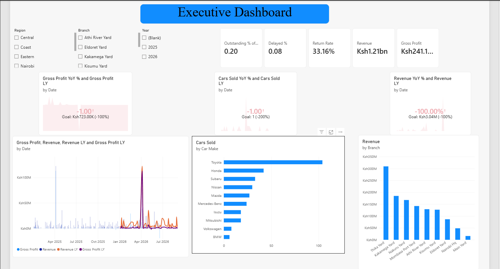

# From Messy CSV to Management Dashboard

A manager opens your report and you're not there to explain it. In five minutes they should know how the business is doing, where it makes and loses money, what looks unusual and what to do next. That was the test for my LuxDev HQ Power BI assessment, built on a messy CSV from JCars Logistics, a vehicle importer and seller in Kenya.

## The data

One row per order, 32 columns, and plenty of problems: prices in KES, USD, EUR and ZAR, amounts like `1.5M`, units written as `two`, ages of `-5` and `121`, rep names like `K1ptoo`, and five different ways of saying "missing". I loaded everything as text first so no bad value was silently turned into an error.

## Cleaning

- **One money parser.** My first version used separate code per column and quietly nulled USD values. One function now detects currency, strips symbols, expands `M` and converts to KES using a single rate record.
- **Exact-match mappings.** Replacing `Gre` with `Grey` turned `Green` into `Greyen`. Whole-value lookup tables fixed it.
- **Flag, don't delete.** Invalid values are nulled for calculation and noted in a `Data Issues` column. Duplicates go to an audit query instead of disappearing.
- **Reconcile.** I compared recorded revenue with `Units × Price × (1 − Discount)`. Results: `[ADD % match / mismatch]`.

## Modelling

I built a star schema with a date table. The trap: joining the fact table to a dimension on a non-unique column multiplies rows. I built each dimension on its own grain, joined on all its columns, and confirmed the row count and total revenue matched the clean table. Measure columns also live in the fact table, otherwise slicers on other dimensions are ignored.

## DAX

Definitions first, formulas second: cancelled orders are excluded from sales, margin uses only rows with both revenue and cost, and logistics is shown separately from gross profit.

```dax
Gross Profit Margin % =
DIVIDE (
    [Gross Profit],
    CALCULATE ( SUM ( Sales_ftTable[Costed Revenue KES] ), Sales_ftTable[Is Cancelled] = 0 )
)
```

Exceptions use the 90th percentile of the data, not arbitrary cut-offs, and an `Exception Score` ranks orders to investigate.

## The report

Seven pages in one flow: executive dashboard, vehicles, geography and sales team, customers and pricing, payments and delivery, returns and exceptions, then insights. It includes slicers, drill-through, a report tooltip and page navigation.



## Findings and recommendations

1. `[Finding, with numbers]`
2. `[Finding]`
3. `[Finding]`

Recommendations: `[3 actions, each tied to a finding]`. The data shows what moved together, not necessarily why.

## Lessons

- Check row counts after every join.
- Use exact-match mappings, not substring replacement.
- Keep unusual rows and flag them.
- Define "revenue" before writing a measure.

Limits: fixed exchange rates, no targets in the data, and no reasons for returns or cancellations.

**Repo:** `(https://github.com/Manu-Data1)`
